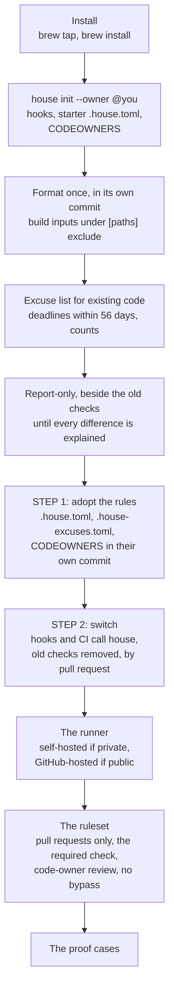
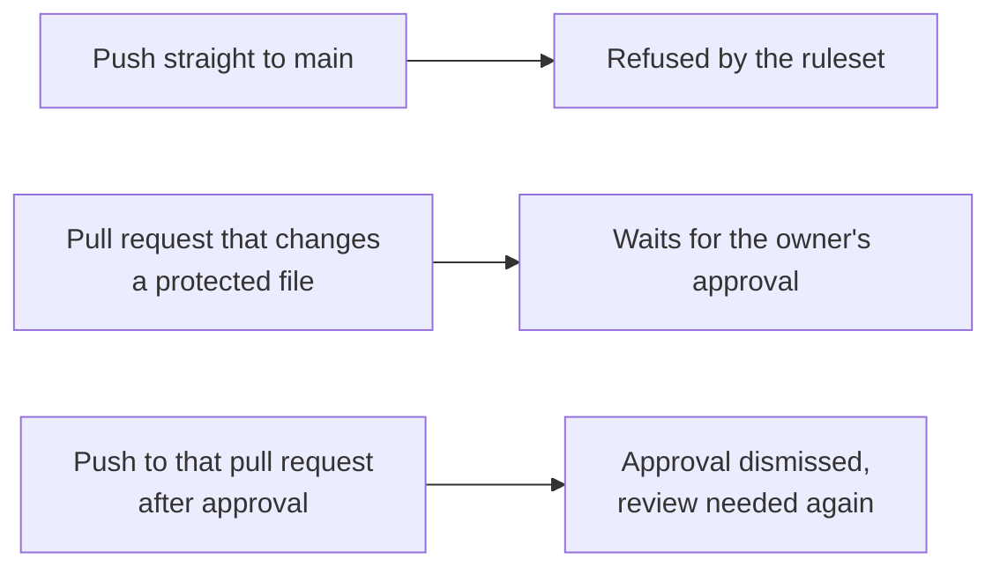

# Adopting house in an existing project

How to move a project that already has its own checks onto house, without a gap in
protection and without a day when nothing is enforced.

**On this page:** [Who it is for](#who-it-is-for) · [The path](#the-path) ·
[The steps](#the-steps) · [The runner](#the-runner) · [The ruleset](#the-ruleset) ·
[The proof cases](#the-proof-cases) · [What can go wrong](#what-can-go-wrong)

---

## Who it is for

A project that already has code, history and some checks (a script, a CI job, a few hooks),
and an owner who wants one set of written rules in their place. The old code will not meet
every rule on day one, so house keeps a dated list of excuses for it: the list may only
shrink, and every entry has a deadline.

For a project with no checks yet, [setup](setup.md) is enough.

---

## The path



---

## The steps

### 1. Install

```sh
brew tap flight-william/housekeeper https://github.com/flight-william/housekeeper
brew install house
```

The tools house calls come from Homebrew too; [setup](setup.md) lists them.

### 2. Run `house init`

```sh
cd your-repo
house init --owner @your-github-user
```

It writes these and prints each: the git hooks (report-only: they show findings but never
block), a starter `.house.toml` naming the tools the repo's files need, and
`.github/CODEOWNERS`, which gives the owner the protected files. An existing hook is left
alone, and house prints the line to add to it. Nothing is committed yet.

A tool setting is written only when it fits the code already there. A repo with Swift files
and no `.swift-format` gets one with the indentation most of those files use (4 spaces, 2
spaces or tabs), so swift-format's own default does not report every line of code written
in another style; with nothing indented to read, init says so and writes none. An existing
setting is never replaced. Read what init wrote before you commit it: it matches the code,
not a decision about it.

### 3. Leave out what the build ignores, and format once

Some tracked files are not the project's code: generated folders, vendored libraries, a
dependency manager's output, design mock-ups. If the project's build or its old checks never
read them, list them under `[paths] exclude` in `.house.toml`, so no tool is handed them:

```toml
[paths]
exclude = ["Generated/", "vendor/", "third_party/"]
```

Then, if the project was never formatted, format it once, in a commit of its own with
nothing else in it (`swift format --in-place --recursive .`, `ruff format`, `cargo fmt`,
`node_modules/.bin/prettier --write .`),
and run its tests on that commit. Do this **before** you count the excuse list. Layout
findings are fixed by the tool in seconds; excusing them only builds a list of thousands of
entries that cannot meet a 56-day deadline. The format commit touches many files, so pick a
day with few open branches, and tell their owners to rebase.

### 4. Write the excuse list for existing code


Run `house check --all`: it runs every tool on every tracked file, not only the changed
ones. What it finds in old code goes into `.house-excuses.toml`, one `[[excuse]]` each, with
the rule, the file, a `deadline`, a `reason` and, to bound it, a `count`. Set `added` to
today, and every deadline within 56 days of it. An excuse covers at most `count` findings, so
new code in an excused file is not excused. A later `house check --all` reports an entry that
matches nothing; delete it.

When one finding fits two entries (the same rule and file, and both symbols in its text), it
goes to the most specific one: the longer `symbol`, then any `symbol` over none, then a
`value` over none. A wider entry never takes a finding a narrower one was written for, and
the order of the entries in the file does not matter. So an entry for one kind of finding
(`symbol = "LineLength"`) and an entry for the rest of the same tool's findings
(`symbol = "format"`) can sit side by side.

### 5. Report-only, beside the old checks

For a while, run both: the old checks and house's report-only hooks. Compare what each one
says. For every difference, decide which is right, then fix the rule, the excuse or the old
check. Move on only when every difference is explained.

### 6. STEP 1: adopt the rules

Put `.house.toml`, `.house-excuses.toml` and `.github/CODEOWNERS` in a commit of their own,
with nothing else in it, and merge it. This comes first for a reason: on the runner, house
reads its rules from the **base** of a pull request, never from the pull request, so a change
cannot judge itself. A base with no `.house.toml` is "cannot check: no rules", and
`house check --stage merge --config-from <base>` refuses. The first list of excuses is not
growth, but it is a protected file, so the commit needs the owner's approval line.

### 7. STEP 2: switch

In a pull request, make the hooks and CI call house and remove the old checks. The starter
hooks end in `|| true`; take that off where house should block. The pull request is judged
with the rules already on the base from step 1.

---

## The runner

CI runs `house check --stage merge --config-from <base>` on a pull request, so the rules come
from the base, and `house check --all` on the main branch. Merge runs what push runs, and the
commit-msg checks on every commit of the pull request
([README, On a runner](../README.md#on-a-runner)). A runner that calls `--stage push`
switches by that one word, and checks out with `fetch-depth: 0`: merge refuses a shallow
clone. The README has a workflow step to copy.

| Repository | Runner | Why |
|---|---|---|
| Private | Self-hosted, with the job-started hook | Your own machine, your own tool versions. |
| Public | GitHub-hosted only | Anyone can open a pull request from a fork; on a self-hosted runner that code would run on your machine. |

**Never a self-hosted runner on a public repository.** house itself refuses to run there
(exit 2), and it also refuses when it cannot read the event payload.

A fork can edit the workflow and skip house, so a self-hosted runner needs a guard outside
every workflow. `runner/job-started.sh` refuses any job from a repository that is not
private. Install it in the runner folder's `.env`, then restart the runner service:

```sh
ACTIONS_RUNNER_HOOK_JOB_STARTED=<path to runner/job-started.sh>
```

---

## The ruleset

In the repository settings, add a ruleset for the main branch. Each line closes a way round
house:

| Setting | What it stops |
|---|---|
| Pull requests only | A direct push to main. |
| The house check is required | A merge while anything is red. |
| Code-owner review is required | A change to a protected file without the owner. |
| Stale approvals are dismissed on a new push | A change slipped in after the owner approved. |
| No bypass, for anyone | The owner skipping their own rules by habit. |

---

## The proof cases

Do not trust the settings; try to break them, with a throwaway branch each time.



All three must hold before the old checks are gone for good.

---

## What can go wrong

- **A second `house` on PATH shadows the old one.** An older copy earlier on PATH runs
  instead of the one you installed, and may not know the newer rules or keys. Check
  `which -a house` and `house --version`, and set `[house] minimum` in `.house.toml`.
- **A commit made during a push.** A commit made on the branch while a push of it is running
  can change what the push checks and sends. Wait for the push to finish.
- **A test suite waits on something no one will answer.** A signing dialog, a locked
  screen, a network call. Each `[tests]` command is stopped at `timeout_seconds` (600 when
  unset) and reported as an R7 finding naming the command and the limit; set a limit that
  fits the suite, and make the suite fail fast where it can. The command's whole process
  group is stopped, so a helper it started (a signing tool waiting on that dialog) goes
  with it, and so is it when house is interrupted (Ctrl-C) or killed. A suite cannot read
  the terminal: one that asks for a password or a passphrase waits until the limit.
- **The base has no rules.** Step 2 before step 1: the runner finds no `.house.toml` on the
  base and cannot check. Adopt the rules in their own commit first.

---

**Next:** [Read the weekly review](review.md) · [Why house](why.md) · [Set up a project](setup.md)
