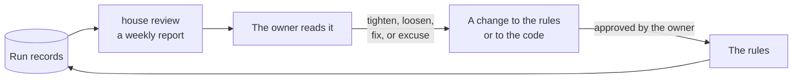

# Reading the weekly review

Every house run adds one line to the run record. `house review` reads those lines and writes
a weekly report: what the rules caught, what they only made noise about, and where the work
keeps going wrong. The report decides nothing. It gives the owner evidence for the next change
to the rules.

**On this page:** [The loop](#the-loop) · [Running it](#running-it) · [What the report holds](#what-the-report-holds) ·
[What to do with each part](#what-to-do-with-each-part) · [The suggestions](#the-suggestions)

---

## The loop



A change to `.house.toml` or `.house-excuses.toml` is a change to a protected file, so it
goes through a pull request and needs the owner's approval. The report never edits a rule.

---

## Running it

```sh
house review [--from YYYY-MM-DD] [--to YYYY-MM-DD] [--repo <path or name>] [--json]
```

It reads the run records (`$HOUSE_LOG_DIR`, else `~/Library/Logs/house/runs`) and prints one
report for the runs that started in the period. The days are UTC days: house writes each
run's start in UTC, a start written with another offset counts under its UTC day, and `--to`
is today in UTC when not given. `--repo`
takes a repo's path or its folder name, for a record folder shared by several repos.
`--json` prints the same report as one JSON object. The exit is 0, or 2 when the record
folder cannot be read.

A weekly look is `house review --from` the day a week ago.

---

## What the report holds

A made-up sample: the whole report over the made-up records in `tests/fixtures/review_docs`,
which a test checks against this page.

```sh
house review --from 2026-11-16 --to 2026-11-22
```

```
house review: 2026-11-16 to 2026-11-22, 10 runs: 6 commit, 3 push, 1 all
2 lines skipped: not house run records
per rule:
  R2: 0 findings, 0 excused, 1 cannot check
  R3: 1 finding, 6 excused, 0 cannot check
  R4: 3 findings, 0 excused, 0 cannot check
5 excused in records that do not say which rule (before house 0.3.0)
per tool:
  gitleaks: 9 runs, 0 findings, 0 excused, 0 cannot check, 4.5 s total, 0.5 s median
  r3: 10 runs, 1 finding, 6 excused, 0 cannot check, 2.0 s total, 0.2 s median
  ruff: 10 runs, 3 findings, 0 excused, 0 cannot check, 10.0 s total, 1.0 s median
  semgrep: 4 runs, 0 findings, 0 excused, 1 cannot check, 60.0 s total, 20.0 s median
repeated places (failed on more than one run):
  R4 src/score.py [ruff C901]: 3 runs
suggestions (to weigh, not orders):
  suggestion: gitleaks never fires: no findings in 9 runs; check that it is handed the files it should read
  suggestion: R3 looks noisy: 6 of 7 findings excused; fix that code, or tune the rule
  suggestion: R4 looks noisy: 3 of 3 left to fix on places that failed before; fix that code, or tune the rule
  suggestion: r3 looks noisy: 6 of 7 findings excused; fix that code, or tune the tool
  suggestion: ruff looks noisy: 3 of 3 left to fix on places that failed before; fix that code, or tune the tool
  suggestion: semgrep takes most of the time: 60.0 of 76.5 s (78%); run it at push only, or hand it fewer files
```

| Part | What it shows |
|---|---|
| **Header** | The period asked for, `--from` to `--to` (a bound not given is the day of the first or last run covered; the cli gives today for `--to`), the number of runs, and the runs per stage: commit, commit-msg, push and all. |
| **lines skipped** | `N lines skipped: not house run records`. The record folder can hold lines another program wrote, or a broken one; they are skipped and counted. So is a blank line, a line that is not valid UTF-8, and a line longer than 1 MiB, which is never held in memory. The line is absent when none were skipped. |
| **record files skipped** | `N record files skipped: not regular files`. Only a regular file named `<YYYY-MM>.jsonl` is read. A folder, a FIFO or a symbolic link with such a name is skipped and counted, never followed or waited on. A regular file that cannot be read stops the review (exit 2). The line is absent when none were skipped. |
| **per rule** | For each rule: the findings left to fix, the excused findings and the cannot-checks. A cannot-check is counted under the rule of the tool that could not run. |
| **excused before 0.3.0** | `N excused in records that do not say which rule (before house 0.3.0)`. A record written before 0.3.0 keeps only the run's excused total, so those excuses cannot be tied to a rule or a tool. They are counted apart. |
| **per tool** | For each tool: the runs it took part in, the same three counts, and its total and median seconds. A tool's seconds in a record must be from 0 to 86400 (a day); a record with any other value was not written by house and is skipped. |
| **repeated places** | `repeated places (failed on more than one run)`: each place (rule, file, the tool's own rule in brackets) that failed on more than one run, most often first. The repo's folder name is added when the report spans repos. `repeated places: none` when there are none. |
| **suggestions** | `suggestions (to weigh, not orders)`, one `suggestion:` line each; see [below](#the-suggestions). `suggestions: none` when there are none. |

Memory grows with the number of distinct repos, rules, tools and places in the record
folder, and with the runs in the period, as for any tool reading its own records; a single
line is capped at 1 MiB. Past 100000 distinct places, rules, tools, stages and repos, or past
a total that does not fit in a 64-bit count, the review stops with
`house review: cannot review: ...` (exit 2), and a shorter period or one repo is the fix.

"Cannot check" is not a finding. It means a tool was missing, crashed or hung, so nothing
about that run's code is known. A rule with many of them is not being enforced.

---

## What to do with each part

There are four moves. Every one that changes a rule needs the owner's approval.

| Move | When | How |
|---|---|---|
| **Tighten** | A rule rarely fires, yet the problems it covers still reach review. Or a limit is far above what the code needs. | Lower the limit or add the tool in `.house.toml`. Run `house check --all` first to see what the new limit finds. |
| **Loosen** | A rule fires often, and nearly every finding is excused or fixed in a way that changes nothing. | Raise the limit, narrow the files it reads, or drop the tool for that stage. State the reason in the commit. |
| **Fix the repeated place** | The same file appears again and again under *repeated places*. | The rule is working; the code is the problem. Fix the cause there: split the function, remove the suppression. |
| **Excuse, with a deadline** | The code cannot be fixed this week and the rule must stay. | Add an entry to `.house-excuses.toml` with a reason, a count and a deadline within 56 days. The list only shrinks: never move a deadline later. |

Read the sections in this order:

1. **Cannot-checks first.** Fix the tool or its install before reading the rest; counts from a
   run that could not check say little.
2. **Repeated places.** They show where the work needs fixing, not the rules.
3. **Per rule and per tool.** Look for rules at zero, and for rules that fire all the time.
4. **Seconds.** Feedback must stay fast; a tool that takes most of the time belongs at a
   later stage, or on fewer files.

---

## The suggestions

| Suggestion | What it means | What to do |
|---|---|---|
| `X never fires: no findings in N runs; ...` | A rule or tool found nothing, excused or left to fix, in the whole period. Only shown after at least 5 runs that checked: a tool's own runs with no cannot-check, and for a rule the runs where a tool that names it checked. Never shown for a rule or tool that ran where a record from before 0.3.0 excused findings without saying whose. | For a rule, check that a tool still checks it, or drop it. For a tool, check it is handed the files it should read. A quiet rule may simply be holding: do not remove it only because it is quiet. |
| `X looks noisy: ...` | Most of its findings were excused (`6 of 10 findings excused`), or most of those left to fix were on places that failed on another run too (`3 of 4 left to fix on places that failed before`), so they were not fixed in between. | Open a few of its findings. If they are real, fix that code, or excuse with a deadline. If they are not, tune the rule or the tool: loosen it. |
| `X takes most of the time: S of T s (P%); ...` | One tool took more than half of all the tools' seconds, when two or more ran. | Run it at push only, or hand it fewer files. |

A suggestion is a prompt to look, not an order. The owner decides.

---

**Next:** [Why house](why.md) · [Adopt house in an existing project](adopting.md) · [Set up a project](setup.md)
