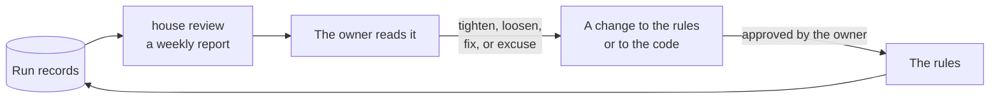

# Reading the weekly review

Every house run adds one line to the run record. `house review` reads those lines and writes
a weekly report: what the rules caught, what they only made noise about, and where the work
keeps going wrong. The report decides nothing. It gives the owner evidence for the next change
to the rules.

**On this page:** [The loop](#the-loop) · [What the report holds](#what-the-report-holds) ·
[What to do with each part](#what-to-do-with-each-part) · [The suggestions](#the-suggestions)

---

## The loop

A change to `.house.toml` or `.house-excuses.toml` is a change to a protected file, so it
goes through a pull request and needs the owner's approval. The report never edits a rule.

---

## What the report holds

| Part | What it shows |
|---|---|
| **Period and runs** | The days the report covers and how many runs each stage had: commit, push and the runner. |
| **Per rule** | For each rule: the findings, how many were excused, and how many runs could not check. |
| **Per tool** | The same counts for each tool, so a tool that fails to run shows apart from a rule that fires. |
| **Repeated places** | Files and lines where the same rule fires again and again. |
| **Tool seconds** | How long each tool took in total, so slow stages are visible. |
| **Suggestions** | A short list the report draws from the rest; see [below](#the-suggestions). |

"Cannot check" is not a finding. It means a tool was missing, crashed or hung, so nothing
about that run's code is known. A rule with many of them is not being enforced.

---

## What to do with each part

There are four moves. Every one ends with the owner's approval where it changes a rule.

| Move | When | How |
|---|---|---|
| **Tighten** | A rule rarely fires, yet the problems it covers still reach review. Or a limit is far above what the code needs. | Lower the limit or add the tool in `.house.toml`. Run `house check --all` first to see what the new limit finds. |
| **Loosen** | A rule fires often, and nearly every finding is dismissed, excused or fixed in a way that changes nothing. | Raise the limit, narrow the files it reads, or drop the tool for that stage. State the reason in the commit. |
| **Fix the repeated place** | The same file or line appears again and again. | The rule is working; the code is the problem. Fix the cause there: split the function, remove the suppression. |
| **Excuse, with a deadline** | The code cannot be fixed this week and the rule must stay. | Add an entry to `.house-excuses.toml` with a reason, a count and a deadline within 56 days. The list only shrinks: never move a deadline later. |

Read the sections in this order:

1. **Cannot-check first.** Fix the tool or its install before reading the rest; counts from a
   run that could not check say little.
2. **Repeated places.** They show where the work needs fixing, not the rules.
3. **Per rule and per tool.** Look for rules at zero, and for rules that fire all the time.
4. **Tool seconds.** Feedback must stay fast; a tool that dominates the run belongs at a
   later stage, or on fewer files.

---

## The suggestions

| Suggestion | What it means | What to do |
|---|---|---|
| **never fires** | A rule or tool found nothing in the whole period. | Check it is wired in and reads the files you expect. If it is, the rule may be holding, or it may be too loose: tighten it, or leave it. Do not remove a rule only because it is quiet. |
| **looks noisy** | A rule fires a great deal, with little change in the code. | Open a few of its findings. If they are real, fix the repeated place or excuse with a deadline. If they are not, loosen the rule. |
| **dominates the run** | One tool takes most of the run's seconds. | Move it to a later stage, hand it fewer files, or replace it with a faster check. |

A suggestion is a prompt to look, not an order. The owner decides.

---

**Next:** [Why house](why.md) · [Adopt house in an existing project](adopting.md) · [Set up a project](setup.md)
