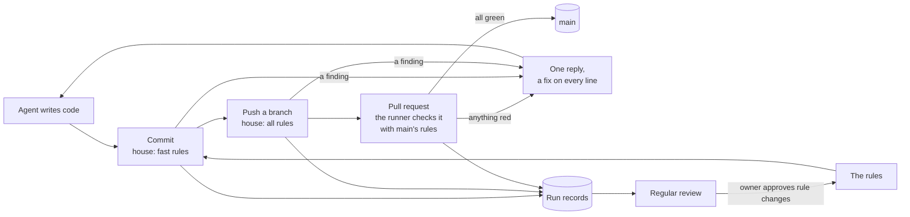

# Why house

> **house lets one developer working with agents scale without losing quality.**

house is groundwork for building software with agents. It does not write code. It makes the
way code is written **consistent, measurable and testable**, and it keeps a record of every
run, so the work gets better over time instead of drifting.

**On this page:** [Key ideas](#key-ideas) · [Who it is for](#who-it-is-for) ·
[The foundation](#the-foundation) · [How it works](#how-it-works) ·
[Does quality improve over time?](#does-quality-improve-over-time) ·
[The people's role](#the-peoples-role)

---

## Key ideas

| | Idea | What it means |
|---|---|---|
| 1 | **Quality is a property of the system, not of a person** | Good code no longer depends on who wrote it. Every change meets the same written rules, the same tests and the same record. |
| 2 | **Feedback is fixed and immediate** | Every finding comes back in seconds, in one format, with its fix: at commit, at push, and before the main branch. |
| 3 | **The rules themselves improve** | Every run is recorded. The records show which rules catch real problems and which are noise, and the rules are tuned with that evidence. |
| 4 | **People's work moves up a level** | From reading every change to deciding what is needed, what "done" means, which rules apply, and how the design should go. |

---

## Who it is for

**Most of all, one developer working with agents.**

- A team has people who catch each other's mistakes. One person with agents has nobody else.
- One person cannot read everything ten agents write. house checks every change the way a
  careful colleague would, without slowing the work down.
- The developer sees only what needs their judgment: what is needed, the rules, the design.
- Their standards stay written down, in the rules and the records, not only in their head.
- Adding a project or an agent adds output, not risk.

Teams gain too, but they already have code review and process. For one developer, house is the
difference between one person's output and a team's.

---

## The foundation

Each step makes the next one possible.

| Step | What it gives |
|---|---|
| **Consistent** | One way to format, name, structure and commit, across every project. Without consistency, nothing can be compared. |
| **Measurable** | Every rule is something a tool can count: lines, complexity, findings, coverage, seconds. |
| **Testable** | Every promise is a test, from what the code does to how it is designed. "Done" means proven, not "looks right". |
| **Feedback loop** | The records show which rules work. The rules are tuned, and agents get the same reply every time, so they learn what to fix. |

With that in place, attention moves to **what the business needs**: what to build, and why.
Agents handle how, and the gate keeps how from drifting.

---

## How it works

- **The rules you care about,** written down once, each mapped to an existing tool: formatters,
  linters, secret scanners, test runners, and Semgrep for the patterns no tool covers.
- **One interface** to every tool, so adding a tool or a language is a small adapter.
- **One reply** for agents: one line per finding, each with its fix.
- **One record** per run, so the rules are tuned with evidence.
- **Checks at every stage:** fast rules at commit, all rules at push, and all rules again on a
  separate runner before anything reaches the main branch. Local checks give fast feedback; the
  runner is where trust is enforced.
- **Rule changes need the owner's approval,** and the list of excused old code can only shrink.

---

## Does quality improve over time?

It can, when three things hold:

| Condition | Why it matters |
|---|---|
| **The loop acts, not only records** | A regular review of the run records turns repeated findings into fixes, and noisy rules into better ones. |
| **Tests carry the meaning** | The gate proves code passes its tests, not that the tests capture what the business needs. Measuring test strength (coverage, mutation testing) and reviewing tests close part of that gap; clear acceptance criteria close the rest. |
| **Design keeps a person's judgment** | Rules keep code clean, but they cannot choose the right architecture. A short design note before building, boundaries a tool can check, and design promises written as tests give design structure. The choices stay with people. |

---

## The people's role

The role moves from checking code to three things:

1. **Saying what is needed,** and how to know it works.
2. **Approving the rules** and every change to them.
3. **Reading the review** of the run records, and deciding what to tighten or loosen.

> The gate stops things getting worse. Clear intent and the feedback loop make them better.

---

**Next:** [Set up a project](setup.md) · [The rules and the tools](../README.md)
