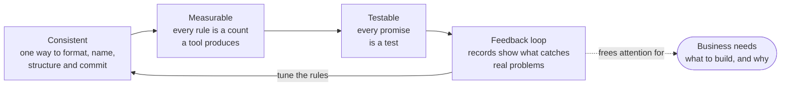
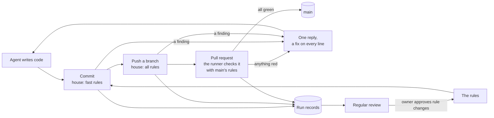

# Why house

house is groundwork for building software with agents. It does not write code. It makes the
way code is written consistent, measurable and testable, and it keeps a record, so the work
can get better over time instead of drifting.

## Key ideas

- **Quality becomes a property of the system, not of a person.** Good code no longer depends on
  who wrote it: every change meets the same written rules, the same tests and the same record.
- **Feedback is fixed and immediate.** Every finding comes back in seconds, in one format, with
  its fix, at commit, at push and before the main branch.
- **The rules themselves improve.** Every run is recorded; the records show which rules catch
  real problems and which are noise, and the rules are tuned with that evidence.
- **People's work moves up a level.** From reading every change to saying what is needed, what
  "done" means, which rules apply, and how the design should go.

## The order matters

1. **Consistent.** One way to format, name, structure and commit, across every project.
   Without consistency, nothing can be compared.
2. **Measurable.** Every rule is something a tool can count: lines, complexity, findings,
   coverage, seconds. Every run is recorded.
3. **Testable.** Every promise is a test, from what the code does to how it is designed. "Done"
   means proven, not "looks right".
4. **A feedback loop.** The records show which rules catch real problems and which are noise.
   The rules are tuned, and agents get the same reply every time, so they learn what to fix.

With that in place, attention moves to what the business needs: what to build, and why.
Agents handle how, and the gate keeps how from drifting.

## How it works

- **The rules you care about,** written down once, each mapped to an existing tool: formatters,
  linters, secret scanners, test runners, Semgrep for the patterns no tool covers.
- **One interface** to every tool, so adding a tool or a language is a small adapter.
- **One reply** for agents: one line per finding, each with its fix.
- **One record** per run, so the rules are tuned with evidence.
- **Checks at every stage:** fast rules at commit, all rules at push, and all rules again on a
  separate runner before anything reaches the main branch. Local checks give fast feedback; the
  runner is where trust is enforced.
- **Changes to the rules need the owner's approval,** and the list of excused old code can only
  shrink.

## Will quality improve over time?

It can, if three things hold:

- **The loop acts, not only records.** A regular review of the run records turns repeated
  findings into fixes, and noisy rules into better ones.
- **Tests carry the meaning.** The gate proves code passes its tests, not that the tests capture
  what the business needs. Measuring how strong the tests are (coverage, mutation testing) and
  reviewing them closes part of that gap; clear acceptance criteria close the rest.
- **Design keeps a person's judgment.** Rules keep code clean, but they cannot choose the right
  architecture. A short design note before building, boundaries a tool can check, and design
  promises written as tests give design structure; the choices stay with people.

So the people's role moves from checking code to three things: saying what is needed and how to
know it works, approving the rules and their changes, and reading the review to decide what to
tighten or loosen. The gate stops things getting worse; clear intent and the feedback loop make
them better.
